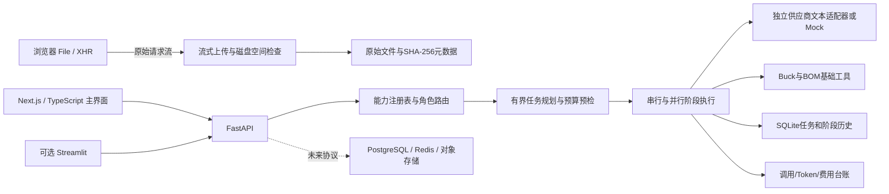

# Engineering AI Studio 架构

当前主线为 Python 3.12、FastAPI、Next.js / TypeScript，使用 SQLite 保存本地记录。Streamlit 是额外可选界面。Mock 模式无需外部服务；完整历史 V2.1 需求不等于本次 MVP 已全部实现，状态见 [roadmap.md](roadmap.md)。

## 路由与执行

八类工程工作通过角色配置映射到供应商、具体模型和能力，业务逻辑不应假设每个供应商都具备视觉、图片生成、Agent SDK 或相同的文本协议。原理图、电源推理、软件、长文档、计算复核、自动执行、低成本检查和图片生成有各自边界；总控选择也需要可配置。

自动、手动和混合调度按任务、附件、用户锁定角色及快速/专业/专家配置生成有界计划。当前规划为规则式实现，不宣称使用 LangGraph 或完成任意 DAG 调度。已有阶段支持串行、并行分析、可选图片分支、重试与汇总，不要求所有任务使用全部角色。图片分支的真实视觉适配尚未实现。

任务调用前进行预算检查、预留费用并限制调用/重试次数。每个尝试记录模型、阶段、状态、耗时、用量来源与费用来源；阶段状态进入 SQLite。取消和失败不会通过伪造模型成功跳过，失败恢复应建立可追踪的后续尝试。正在执行的外部请求即使本地取消，也可能已经被供应商计费。

SQLite 保存任务与阶段历史，原始文件与元数据存于本地磁盘。调度器和上传配额锁仍属于单个进程，因此只运行一个后端 worker/副本。重启可恢复历史不等于自动继续未完成的真实 HTTP 请求，也不等于分布式执行。

## 独立供应商与能力验证

- Qwen：DashScope 的 OpenAI 兼容 Chat 接口，仍独立定义能力和参数。
- OpenAI：Responses API，与 Chat Completions 请求/返回结构不同。
- Anthropic：Messages API，使用其专用认证和消息格式。
- Moonshot：独立 Chat 适配器及自己的长上下文能力约束。
- DeepSeek：独立 Chat 适配器，包含其用量/缓存信息映射。

`ModelRequest`、`ModelResponse` 与 `ProviderError` 是内部契约。共享 HTTP 错误与用量工具不替代供应商专有序列化。真实适配器仅支持已实现的文本路径；不能把附件路径或前一个模型的描述当成真实视觉输入。OpenAI、Claude、DeepSeek、豆包、GLM 均有独立适配器边界。豆包/GLM 的真实调用尚未实现；Qwen/Moonshot 是额外文本实现。模拟实例可演示全部供应商的工作流，但不证明真实接入可用。

配置管理只对外返回脱敏状态。真实调用需要准确 model ID、后端密钥与具体配置的连接测试。连接测试是极小的真实文本调用，可能收费；它只验证测试时的具体文本模型访问，不证明视觉、Agent SDK 或所有模型可用。变更模型、地址或参数应使旧验证状态失效。

需求书中的目标模型名称均未在当前账号上通过真实服务验证，供应商协议单元测试使用 HTTP mock transport。这与 MockProvider 的工程流程演示是两种不同测试，都不能标成真实账号连通性通过。

## 上传与本地数据

Next.js 主界面的浏览器原生 File 请求经独立上传 Route Handler 转发原始数据流；可选 Streamlit 使用原生 File/XHR 直传 FastAPI，避免将整个文件交给默认上传组件读取。服务端边接收边写盘并计算 SHA-256，使用生成的文件标识符和独立元数据，客户端名称不控制真实存储路径。MIME 与文件扩展名仅作元数据。

默认不设产品层固定单文件字节上限或总字节配额；每块写入时检查实际目标磁盘可用空间与保留量。管理员可显式设置资源策略上限，文件数量、任务附件数和并发数也有有界配置。这些限制与外部 API、代理或文件系统限制必须如实说明，不能宣称真正无限上传。

未知格式保存原件并标为未解析，不执行、不解压、不将上传视作代码运行授权。分片上传、断点续传、异步大文件解析、对象存储、RAG 与恶意文件扫描尚未实现。扩展接口包括 MultipartStorage 的初始化/上传片/完成/中止契约，后续实现仍需鉴权、校验、幂等和过期清理。

## 费用与工程证据

Token 区分供应商返回、估算与 Mock。缓存信息只有供应商明确返回时才有效。使用配置的每百万 Token 单价估算费用，并记录价格/来源；没有价格或没有真实用量时不得声称取得精确账单。任务、每日及每月台账与预留机制限制后续调用，但最终供应商账单仍需对账，失败或超时的实际费用可能未知。

确定性 Buck 占空比和 BOM CSV 结构工具有独立测试。完整电感/损耗计算、波形 CSV/真实曲线、ngspice、PDF/RAG 与 KiCad 连接分析按后续阶段实现。工程结果应区分事实、理论推导、仿真、测量和假设；当前模拟输出不能作为设计批准或已证实根因。

PostgreSQL、Redis、对象存储、EmbeddedSoftwareAgent、Claude Agent SDK、图片生成、Skills、案例审核与评测集保留接口或路线图位置。保存案例不会自动训练底层模型；软件 Agent 和真实硬件操作不在 V0.1 执行范围。
